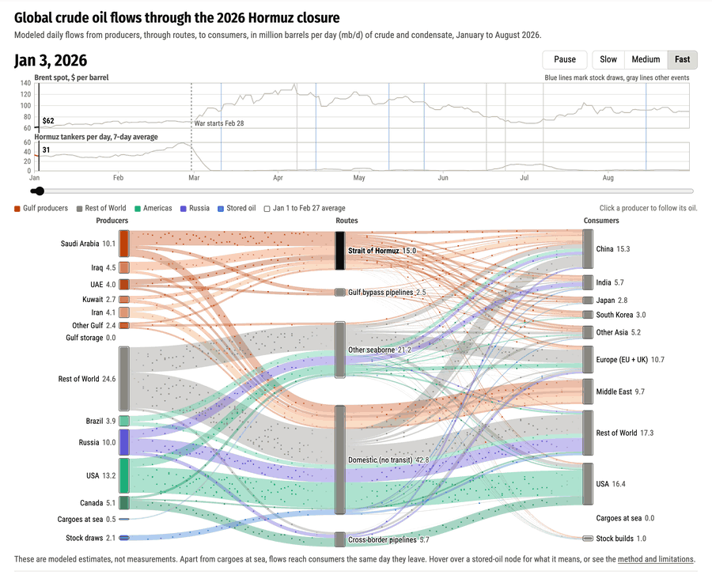

# Global crude oil flows through the 2026 Hormuz closure

An interactive graphic of modeled daily crude oil flows from producers, through routes, to consumers, from January to August 2026.

**View it at <https://jhelvy.github.io/2026-global-oil-flows/>**

The flows are modeled estimates, not measurements. The [Method page](https://jhelvy.github.io/2026-global-oil-flows/methods.html) covers the sources and how far to trust each number.
